<p align="center">
  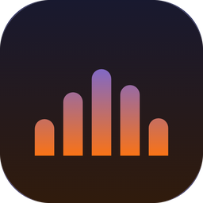
</p>

<h1 align="center">Emran · عِمران</h1>
<p align="center">
  <strong>الصلاة عمران الروح — "Salah is the prosperity of the soul."</strong>
</p>

<p align="center">
  <a href="https://kotlinlang.org/"></a>
  <a href="https://developer.android.com/jetpack/compose"></a>
  <a href="https://github.com/SammyNashed/ratl"></a>
  <a href="LICENSE"></a>
  
  
</p>

<p align="center">
  A free, open-source Islamic companion for Android, in Arabic and English. Prayer
  times with iqama and an adhan that respects your phone, the Madinah mushaf with
  eleven reciters, a choice of tafsir and on-device Hifz checking, sahih hadith,
  adhkar, a Hijri calendar and twenty home-screen widgets, all under a sky that
  follows the real sun where you are. No account, no ads, no analytics.
</p>

<p align="center">
  <a href="https://t.me/emran_app"><strong>Download from the Telegram channel</strong></a>
  · <a href="https://github.com/SammyNashed/Emran/releases/latest">GitHub releases</a>
</p>

<p align="center">
  <a href="https://apps.obtainium.imranr.dev/redirect?r=obtainium://app/%7B%22id%22%3A%22io.github.sammynashed.emran%22%2C%22url%22%3A%22https%3A%2F%2Fgithub.com%2FSammyNashed%2FEmran%22%2C%22author%22%3A%22SammyNashed%22%2C%22name%22%3A%22Emran%22%2C%22additionalSettings%22%3A%22%7B%5C%22apkFilterRegEx%5C%22%3A%20%5C%22fdroid%5C%22%7D%22%7D"></a>
  <br />
  <sub>Obtainium installs Emran from these releases and keeps it updated.</sub>
  <br />
  <sub>If Emran is useful to you, a ⭐ star on this repo helps other people find it.</sub>
</p>

---

<p align="center">
  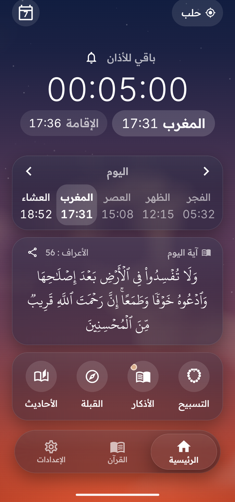
  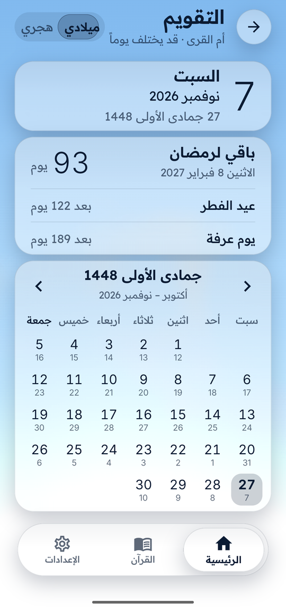
  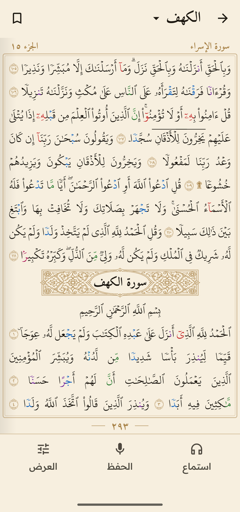
  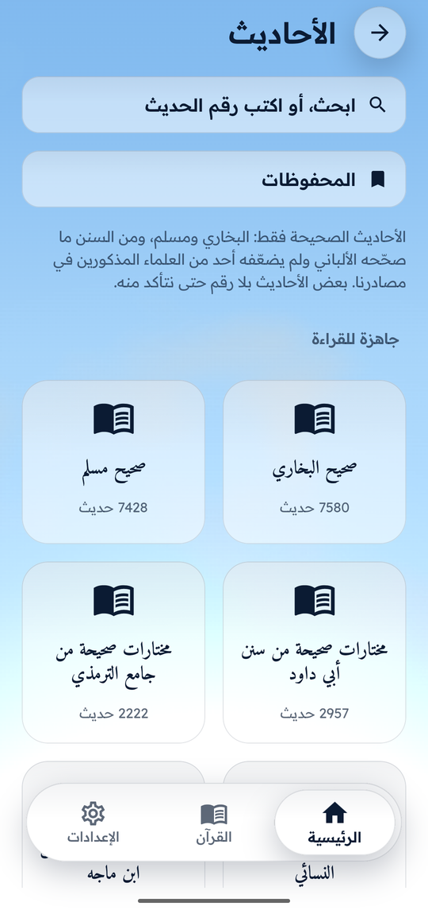
  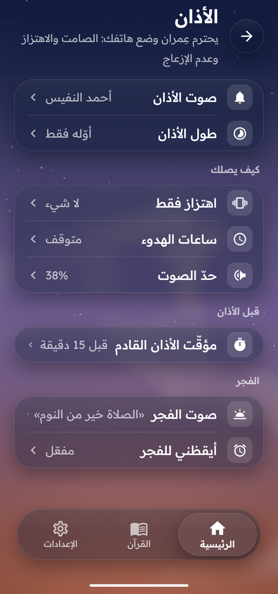
</p>
<p align="center">
  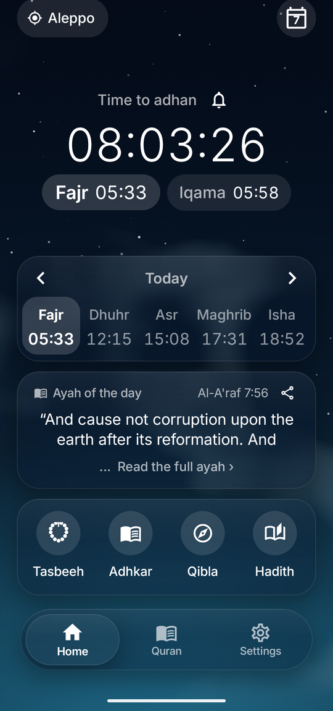
  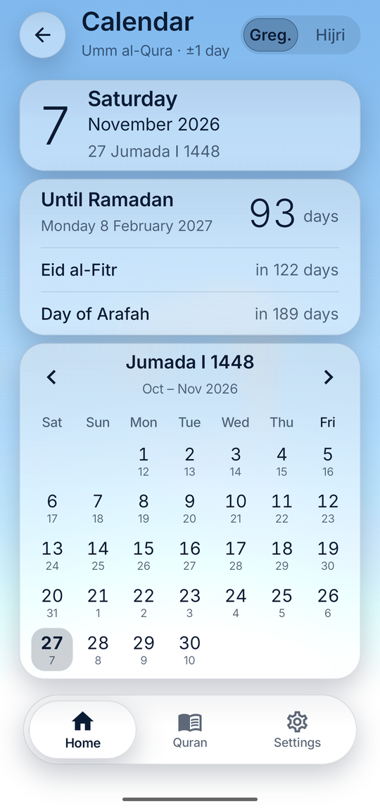
  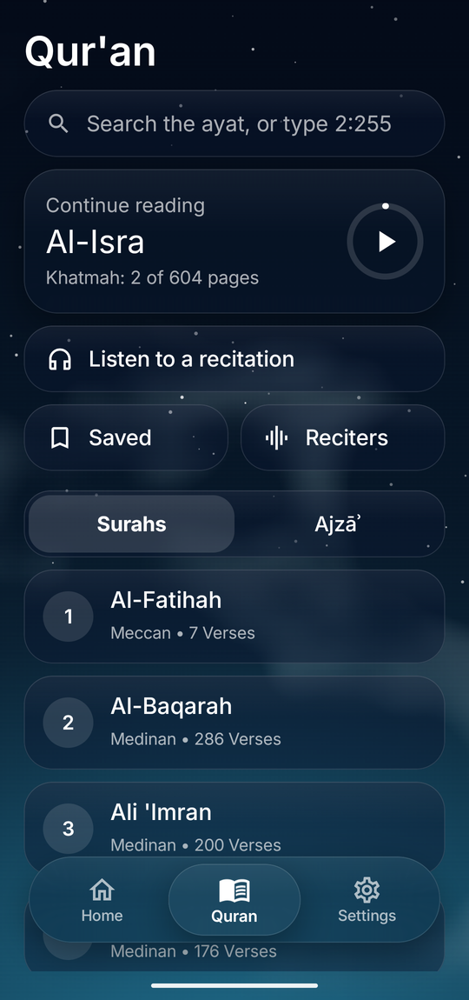
  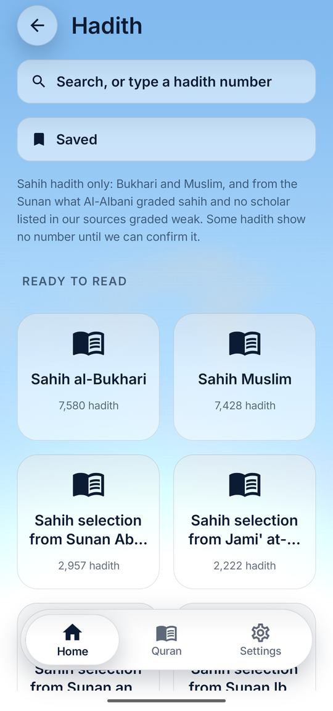
  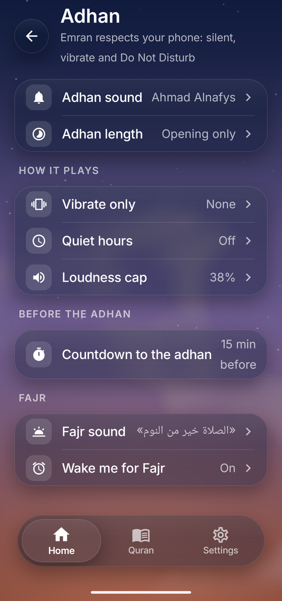
</p>
<p align="center"><sub>The whole app works in Arabic and in English. The sky is the real one: ember at Maghrib, bright by day, navy at night.</sub></p>

## ✨ What's inside

### 🌅 A living sky
Every screen sits on a sky computed from the sun's real position at your location:
navy before Fajr, dawn colours at sunrise, bright day, ember at Maghrib. Clouds are
an AGSL shader rendered at low resolution, and the text colour switches between
light and dark ink as the sky changes, so it stays readable at every hour. Cards
and the dock are frosted glass.

### 🕌 Prayer times, iqama & calendar
* **Home** counts down to the next adhan, then to its iqama. Under it are the day's
  five prayers in one strip (swipe or use the arrows to see another day), the ayah
  of the day and shortcuts to the masbaha, adhkar, Qibla and hadith.
* **Iqama times** per prayer, set to your mosque's delay after the adhan.
* Offline calculation for any coordinate or one of 164 bundled cities, with
  seventeen published conventions: Muslim World League, ISNA, Egyptian, Karachi,
  Umm al-Qura, Dubai, Jordan, Morocco, Tunisia, JAKIM (Malaysia), Kemenag
  (Indonesia), Qatar, Kuwait, Singapore, Diyanet, Tehran and Ja'fari. Custom angles,
  Shafi'i or Hanafi Asr, high-latitude rules and per-prayer fine-tuning are there
  too. Malaysia, Indonesia and Turkey were checked minute by minute against their
  governments' own timetables.
* **Follow my location** (optional) updates the times when you travel and picks the
  convention used where you are.
* **Hijri calendar**: today in Hijri and Gregorian, the days left to Ramadan, Eid and
  Arafah, and a month grid with both dates (Umm al-Qura).

### 🔔 An adhan that respects your phone
* Silent, vibrate and Do Not Disturb are respected, and the adhan follows the
  notification volume and fades in instead of blasting.
* Per prayer: adhan or vibrate only. Quiet hours for lectures or work, a loudness
  cap, and an optional countdown notification before the adhan.
* **Adhan length**: the opening only, or the whole adhan, by Ahmad Al-Nafees,
  Mishary Alafasy or Saad Al-Ghamdi.
* **Fajr sound**: the adhan, or only "As-salatu khayrun min an-nawm" in Alafasy's
  voice.
* **Wake me for Fajr** (off by default): rings like an alarm, even on silent, at a
  volume you choose.
* Exact alarms, re-armed after a reboot, an app update, or a time or time zone
  change. A one-time guide walks people through the battery and autostart settings
  that Xiaomi, Samsung and others use to kill alarms.

### 📖 Qur'an
* **The Madinah mushaf page**: 604 pages, 15 lines each, set in the KFGQPC Uthmanic
  Hafs font with the King Fahd Complex's own text, drawn line by line on a canvas.
  Turn the phone sideways to read at full width.
* Search by words (diacritics ignored) or by reference like `2:255`, surah and juz
  lists, a continue card with a khatmah ring, and one bookmark per surah.
* **Tafsir of your choice**: tap any ayah for its meaning in Al-Mukhtasar (Arabic or
  English), Al-Muyassar, As-Sa'di or Al-Jalalayn, or add another tafsir from a file.
* **Recitation**: eleven reciters (Alafasy, Al-Muaiqly, Al-Dosari, Al-Juhany,
  Al-Shatri, Al-Qatami, Al-Ghamdi, Al-Husary, Abdul Basit, Al-Minshawi and Islam
  Sobhi). Download a surah or the whole Qur'an, then listen offline with the playing
  ayah highlighted and the page following along (Islam Sobhi plays whole surahs,
  without the highlight). A full player has a whole-surah seek bar, repeat for an
  ayah or a surah, a queue and lock-screen controls.
* **Hifz mode**: recite from memory and the words reveal themselves as you say
  them. Speech is checked on the phone by [RATL](https://github.com/SammyNashed/ratl);
  the model ships inside the app and nothing you say ever leaves the device.

### 📚 Hadith, adhkar & masbaha
* **Sahih hadith only**: Sahih al-Bukhari and Sahih Muslim in full, and from Abu
  Dawud, at-Tirmidhi, an-Nasa'i and Ibn Majah only the hadith that al-Albani graded
  sahih and that no scholar in the sources graded weak. Search finds the numbers
  people actually cite.
* Morning and evening adhkar, Hisn al-Muslim and your own adhkar, with sources.
* A masbaha with a string of 33 beads, the classic tasbihat and your own, with sound
  and vibration.
* Share any ayah, hadith or dhikr as a picture: a hadith becomes an open book, a
  dhikr sits over a city at the hour it is said.

### 🧭 Qibla
A compass with magnetic-declination correction and calibration hints. With camera
permission it becomes a camera view with the Kaaba floating in the Qibla direction
(preview only, nothing is recorded or stored).

### 🪟 Home-screen widgets
Twenty glass widgets: the next prayer with a live countdown, the day's prayers as a
table, a row or a progress bar, clocks in Western or Arabic digits, the weekday and
the Hijri month in Arabic calligraphy, the Hijri and Gregorian dates, a month
calendar, the year in dots, the ayah of the day and the next occasion. They redraw
themselves at every prayer time and at midnight, so a phone that holds back
background work can't leave one stuck on the wrong prayer.

<p align="center">
  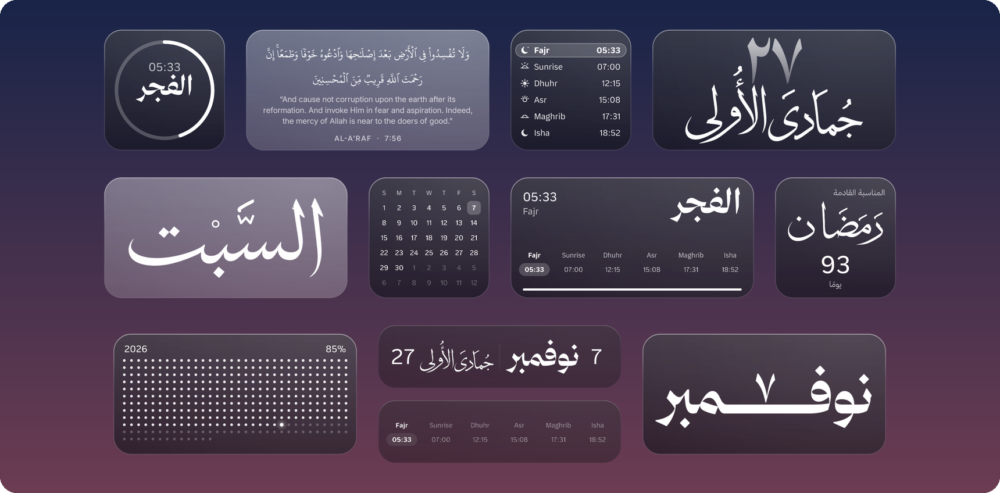
</p>

---

## 🔒 Privacy

Emran collects nothing, shares nothing and sells nothing. There is no account, no
analytics, no ad SDK and no crash reporter. Prayer times, the Qur'an, Hifz, adhkar
and every hadith book work with no internet at all.

The app goes online in exactly two cases, both started by you: **Check for updates**
in Settings, and **downloading a reciter's audio**.

| Permission | Why |
| :--- | :--- |
| `INTERNET` | Check for updates and recitation downloads, only when you tap them |
| `ACCESS_COARSE/FINE_LOCATION` | Your prayer times and Qibla. Optional, you can pick a city instead |
| `SCHEDULE_EXACT_ALARM` / `USE_EXACT_ALARM` | The adhan at the exact minute, not in a batched window |
| `RECEIVE_BOOT_COMPLETED` | Re-arm the adhan after a reboot |
| `POST_NOTIFICATIONS` | Prayer and adhkar alerts on Android 13+ |
| `RECORD_AUDIO` | Hifz mode. Audio is processed on the phone and never stored or sent |
| `CAMERA` | Optional camera Qibla view, preview only |
| `FOREGROUND_SERVICE_MEDIA_PLAYBACK` / `_DATA_SYNC` | Playing recitation or a whole adhan, and downloading recitation in the background |
| `REQUEST_INSTALL_PACKAGES` | Applying a small update file you open from the Telegram channel; Android asks you to confirm |
| `REQUEST_IGNORE_BATTERY_OPTIMIZATIONS` | Optional, from Settings, keeps the adhan reliable under Doze |
| `VIBRATE` | Masbaha, button feedback and vibrate-only prayers |
| `SYSTEM_ALERT_WINDOW` | Optional floating dhikr card over other apps, off by default (in the source now, arrives in the next update) |

---

## 🕰 Time zone handling

Worth calling out, because it is the part most prayer apps get quietly wrong.

Emran stores each location as an **IANA time zone identifier**, never as a fixed
UTC offset. Solar events are computed as absolute instants in universal time and
only converted to wall-clock time at the very end, through `java.time`'s time zone
database.

This matters more than it sounds. **77 of Emran's 164 bundled cities observe
daylight saving time.** An earlier version stored Chicago as `-6.0`, which is
correct in January and an hour wrong from March to November. Working in instants
also means Morocco's Ramadan shift and the southern hemisphere's inverted summer
are handled automatically. Times are rounded up to the minute, so the adhan is
never early.

The calculation is covered by tests that cross-check sunrise and sunset against an
**independently implemented NOAA solar algorithm** across several cities and dates.

---

## 🛠 Tech

* **Kotlin 2.2**, **Jetpack Compose**, MVVM with `StateFlow`
* **AGSL** shaders for the sky, a custom liquid-glass dock and frosted panes
* **Media3** for recitation (gapless per-ayah playlists, media session)
* **ONNX Runtime** running RATL's alignment model for Hifz
* Bitmap-drawn **RemoteViews** widgets redrawn by exact alarms, **Room**,
  **WorkManager**, **AlarmManager**

---

## ⚡ Building

The [RATL](https://github.com/SammyNashed/ratl) engine is a git submodule, built
together with the app, so clone recursively:

```bash
git clone --recursive https://github.com/SammyNashed/Emran.git
cd Emran

./gradlew assembleFullDebug        # debug APK
./gradlew testFullDebugUnitTest    # tests
./gradlew assembleFullRelease      # release APKs (per ABI + universal)
./gradlew assembleFdroidRelease    # the F-Droid / Obtainium flavour
```

Two flavours: `full` can install the small update files from the Telegram channel;
`fdroid` has no self-update and no install permission. Needs Android SDK 36
(`minSdk` 24) and JDK 21. Release signing is read from `KEYSTORE_PATH`,
`STORE_PASSWORD`, `KEY_ALIAS` and `KEY_PASSWORD`; without them the release build is
unsigned rather than failing.

---

## 🤝 Contributing

Contributions are welcome, especially:

* **Translations.** UI strings live in `ui/localization/Localizations.kt`
  (Arabic and English today).
* **Adhkar content.** Every entry needs a verifiable source; see
  [`docs/adhkar-format.md`](docs/adhkar-format.md).
* **Prayer calculation conventions.** New methods need a citation for their angles.

Anything touching prayer times must come with tests. That code is the reason
someone wakes for Fajr.

---

## 📚 Credits

* Qur'an text and font: King Fahd Glorious Qur'an Printing Complex (KFGQPC Uthmanic
  Hafs v22, via [nuqayah/qpc-fonts](https://github.com/nuqayah/qpc-fonts))
* Translation: Saheeh International · Tafsir: Al-Mukhtasar, Al-Muyassar, As-Sa'di and
  Al-Jalalayn (via [spa5k/tafsir_api](https://github.com/spa5k/tafsir_api))
* Hadith: [fawazahmed0/hadith-api](https://github.com/fawazahmed0/hadith-api)
  (Unlicense), with missing Muslim narrations from Open-Hadith-Data (ODbL)
* Recitation audio: [EveryAyah](https://everyayah.com), [mp3quran.net](https://mp3quran.net)
  and [Way2Quran](https://way2quran.com)
* Fonts: Inter, Readex Pro, Amiri, Bodoni Moda, Scheherazade New, AMoshref-Thulth
  (SIL OFL, licences in `assets/licenses/`). Widget lettering is drawn from images of
  words set in the thmanyah typeface; the font itself is not included.
* Everyone on the in-app thank-you wall who tested Emran and sent feedback

---

## ⚖️ License

Emran is licensed under the **GNU General Public License v3.0**. See [LICENSE](LICENSE).

### A note on the author's intent

Emran was written for the Muslim community, freely, seeking the pleasure of Allah.
The author's wish is that **nobody profits from it commercially**, not others and
not the author.

GPL-3.0 was chosen deliberately over a licence that bans commercial use outright.
A non-commercial licence is not open source: F-Droid and similar repositories will
not distribute it. GPL-3.0 instead requires that **any fork or modified build
publish its full source under the same terms**, which forbids the outcome actually
worth preventing: someone re-skinning Emran, adding advertising or a subscription,
and shipping it closed.

If you fork Emran, please honour that intent: keep it free, keep it open, and keep
it free of advertising.

---

<p align="center">
  <em>Free, open source, and built to support daily Salah.</em>
</p>
