<p align="center">
  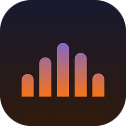
</p>

<h1 align="center">Emran · عِمران</h1>
<p align="center">
  <strong>الصلاة عمران الروح — "Salah is the prosperity of the soul."</strong>
</p>

<p align="center">
  <a href="https://kotlinlang.org/"></a>
  <a href="https://developer.android.com/jetpack/compose"></a>
  <a href="https://github.com/SammyNashed/ratl"></a>
  <a href="LICENSE"></a>
  
  
</p>

<p align="center">
  A free, open-source Islamic companion for Android, Arabic first. Prayer times and
  adhan, the Madinah mushaf with recitation and on-device Hifz checking, Qibla,
  masbaha, adhkar and twelve hadith books, all under a sky that follows the real
  sun where you are. No account, no ads, no analytics.
</p>

<p align="center">
  <a href="https://t.me/emran_app"><strong>Download from the Telegram channel</strong></a>
</p>

---

<p align="center">
  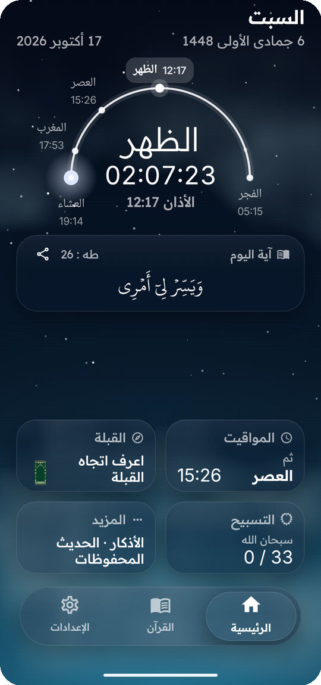
  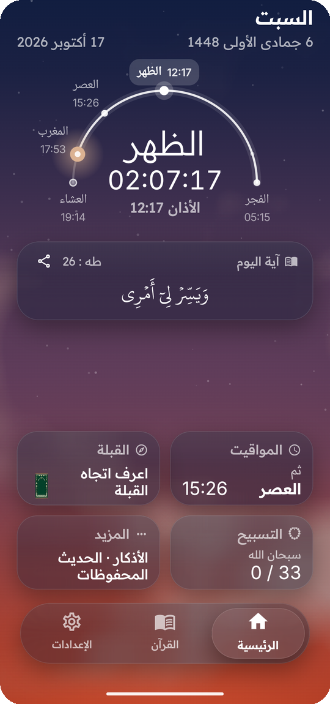
  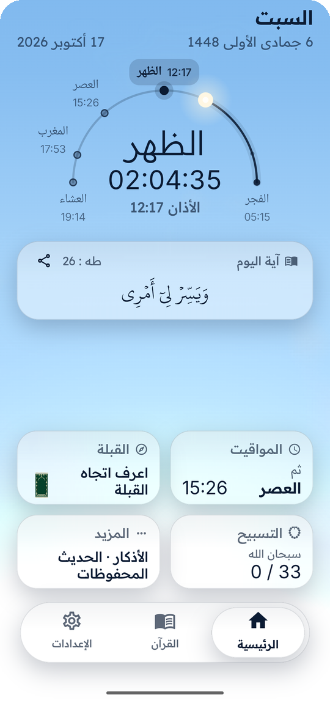
  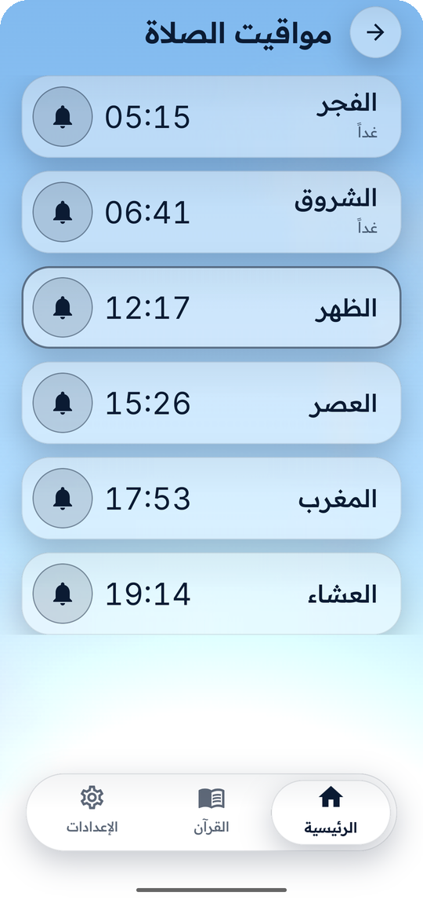
  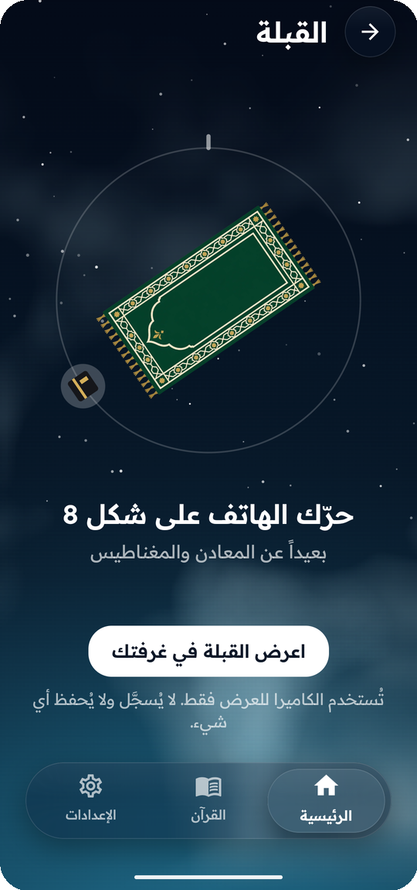
</p>
<p align="center">
  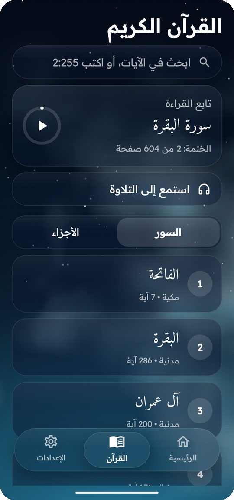
  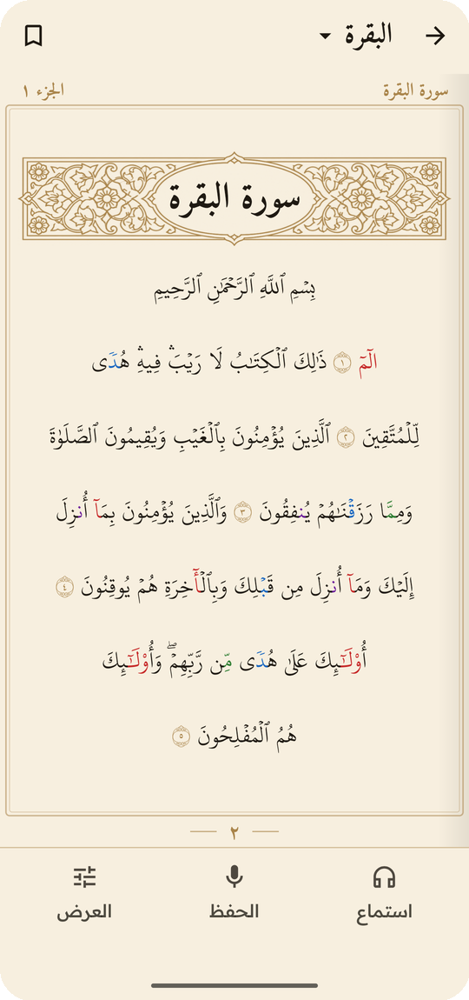
  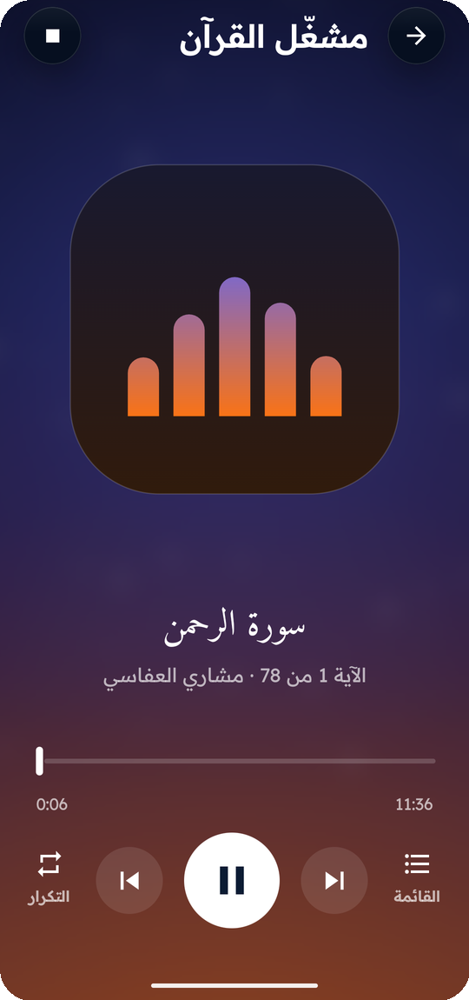
  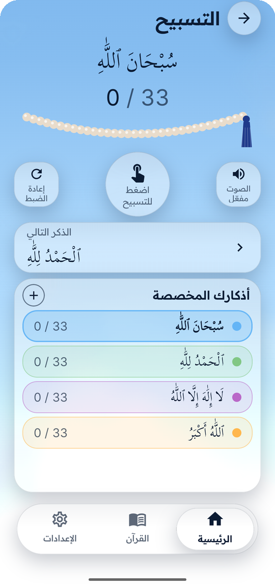
  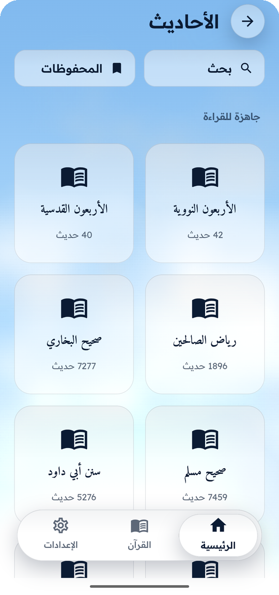
</p>
<p align="center"><sub>The same Home screen at night, at Maghrib and by day: the sky follows the real sun.</sub></p>

## ✨ What's inside

### 🌅 A living sky
Every screen sits on a sky computed from the sun's real position at your location:
navy before Fajr, dawn colours at sunrise, bright day, ember at Maghrib. Clouds are
an AGSL shader rendered at low resolution, and the text colour switches between
light and dark ink as the sky changes, so it stays readable at every hour. Cards
and the dock are frosted glass.

### 🕌 Prayer times & adhan
* Offline calculation for any coordinate or bundled city, with twelve published
  conventions (Muslim World League, ISNA, Egyptian, Umm al-Qura, Karachi, Dubai,
  Qatar, Kuwait, Singapore, Diyanet, Tehran, Ja'fari) plus custom angles, Shafi'i or
  Hanafi Asr, high-latitude rules and per-prayer fine-tuning.
* Home shows the day as an arc with every prayer on it, the next prayer and a
  countdown, the Hijri date in words, and an ayah of the day with its tafsir.
* Exact alarms for the adhan, re-armed after a reboot, an app update, or a time or
  time zone change. A one-time guide walks people through the battery and
  autostart settings that Xiaomi, Samsung and others use to kill alarms.
* Morning and evening adhkar reminders, 12 or 24 hour clock.

### 📖 Qur'an
* **The Madinah mushaf page**: 604 pages, 15 lines each, set in the KFGQPC Uthmanic
  Hafs font with the King Fahd Complex's own text, drawn line by line on a canvas.
* Search by words (diacritics ignored) or by reference like `2:255`, surah and juz
  lists, a continue card with a khatmah ring, and one bookmark per surah.
* Tap any ayah for its meaning (Tafsir al-Muyassar, or Saheeh International in
  English).
* **Recitation**: ten reciters (Alafasy, Al-Muaiqly, Al-Dosari, Al-Juhany,
  Al-Shatri, Al-Qatami, Al-Ghamdi, Al-Husary, Abdul Basit, Al-Minshawi). Download a
  surah or the whole Qur'an, then listen offline with the playing ayah highlighted
  and the page following along. A full player has a whole-surah seek bar, repeat
  for an ayah or a surah, a queue, lock-screen controls, and the Emran logo moving
  with the reciter's voice.
* **Hifz mode**: recite from memory and the words reveal themselves as you say
  them. Speech is checked on the phone by [RATL](https://github.com/SammyNashed/ratl);
  the model ships inside the app and nothing you say ever leaves the device.

### 🧭 Qibla
A compass with magnetic-declination correction and calibration hints. With camera
permission it becomes a camera view with the Kaaba floating in the Qibla direction
(preview only, nothing is recorded or stored).

### 📿 Masbaha, adhkar & hadith
* A masbaha with a string of 33 beads, the classic tasbihat and your own, with sound
  and vibration.
* 55 core adhkar with Arabic, transliteration, translation and source, plus 223
  items from Hisn al-Muslim kept in their own section, and your own adhkar.
* **Twelve hadith books inside the app**: Riyad as-Salihin, the Forty of an-Nawawi,
  the Forty Qudsi, Sahih al-Bukhari, Sahih Muslim, Abi Dawud, at-Tirmidhi,
  an-Nasa'i, Ibn Majah, Muwatta Malik, ad-Darimi and Bulugh al-Maram. Search,
  bookmarks, and Hadith of the Day.
* Share any ayah, hadith or dhikr as a picture card.

### 🪟 Home-screen widgets
Ten glass widgets: next prayer with a live countdown, the day's prayer table,
prayer progress, a clock, the day name in Thuluth calligraphy or in English, the
Hijri date, the Hijri month, the ayah of the day, and the next occasion.

<p align="center">
  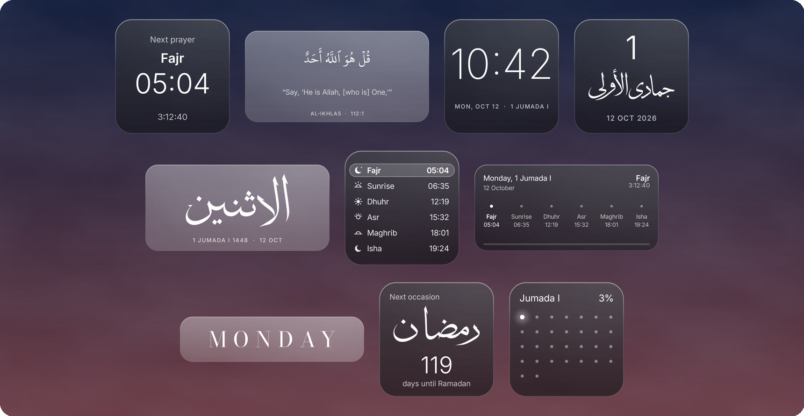
</p>

---

## 🔒 Privacy

Emran collects nothing, shares nothing and sells nothing. There is no account, no
analytics, no ad SDK and no crash reporter. Prayer times, the Qur'an, Hifz, adhkar
and every hadith book work with no internet at all.

The app goes online in exactly two cases, both started by you: **Check for updates**
in Settings, and **downloading a reciter's audio**.

| Permission | Why |
| :--- | :--- |
| `INTERNET` | Check for updates and recitation downloads, only when you tap them |
| `ACCESS_COARSE/FINE_LOCATION` | Your prayer times and Qibla. Optional, you can pick a city instead |
| `SCHEDULE_EXACT_ALARM` / `USE_EXACT_ALARM` | The adhan at the exact minute, not in a batched window |
| `RECEIVE_BOOT_COMPLETED` | Re-arm the adhan after a reboot |
| `POST_NOTIFICATIONS` | Prayer and adhkar alerts on Android 13+ |
| `RECORD_AUDIO` | Hifz mode. Audio is processed on the phone and never stored or sent |
| `CAMERA` | Optional camera Qibla view, preview only |
| `FOREGROUND_SERVICE_MEDIA_PLAYBACK` / `_DATA_SYNC` | Playing recitation and downloading it in the background |
| `REQUEST_INSTALL_PACKAGES` | Applying a small update file you open from the Telegram channel; Android asks you to confirm |
| `REQUEST_IGNORE_BATTERY_OPTIMIZATIONS` | Optional, from Settings, keeps the adhan reliable under Doze |
| `VIBRATE` | Masbaha and button feedback |

---

## 🕰 Time zone handling

Worth calling out, because it is the part most prayer apps get quietly wrong.

Emran stores each location as an **IANA time zone identifier**, never as a fixed
UTC offset. Solar events are computed as absolute instants in universal time and
only converted to wall-clock time at the very end, through `java.time`'s time zone
database.

This matters more than it sounds. **77 of Emran's 164 bundled cities observe
daylight saving time.** An earlier version stored Chicago as `-6.0`, which is
correct in January and an hour wrong from March to November. Working in instants
also means Morocco's Ramadan shift and the southern hemisphere's inverted summer
are handled automatically. Times are rounded up to the minute, so the adhan is
never early.

The calculation is covered by tests that cross-check sunrise and sunset against an
**independently implemented NOAA solar algorithm** across several cities and dates.

---

## 🛠 Tech

* **Kotlin 2.2**, **Jetpack Compose**, MVVM with `StateFlow`
* **AGSL** shaders for the sky, a custom liquid-glass dock and frosted panes
* **Media3** for recitation (gapless per-ayah playlists, media session)
* **ONNX Runtime** running RATL's alignment model for Hifz
* **Glance** + bitmap-drawn widgets, **Room**, **WorkManager**, **AlarmManager**

---

## ⚡ Building

Emran compiles against the [RATL](https://github.com/SammyNashed/ratl) engine as a
Gradle composite build, so clone both side by side:

```bash
git clone https://github.com/SammyNashed/ratl.git
git clone https://github.com/SammyNashed/Emran.git
cd Emran

./gradlew assembleDebug        # debug APK
./gradlew testDebugUnitTest    # tests
./gradlew assembleRelease      # release APKs (per ABI + universal)
```

Needs Android SDK 36 (`minSdk` 24) and JDK 21. Release signing is read from
`KEYSTORE_PATH`, `STORE_PASSWORD`, `KEY_ALIAS` and `KEY_PASSWORD`; without them the
release build is unsigned rather than failing.

---

## 🤝 Contributing

Contributions are welcome, especially:

* **Translations.** UI strings live in `ui/localization/Localizations.kt`
  (Arabic and English today).
* **Adhkar content.** Every entry needs a verifiable source; see
  [`docs/adhkar-format.md`](docs/adhkar-format.md).
* **Prayer calculation conventions.** New methods need a citation for their angles.

Anything touching prayer times must come with tests. That code is the reason
someone wakes for Fajr.

---

## 📚 Credits

* Qur'an text and font: King Fahd Glorious Qur'an Printing Complex (KFGQPC Uthmanic
  Hafs v22, via [nuqayah/qpc-fonts](https://github.com/nuqayah/qpc-fonts))
* Translation: Saheeh International · Tafsir: al-Muyassar
* Recitation audio: [EveryAyah](https://everyayah.com)
* Fonts: Inter, Readex Pro, Amiri, Bodoni Moda, Scheherazade New (SIL OFL, licences in
  `assets/licenses/`)
* Everyone on the in-app thank-you wall who tested Emran and sent feedback

---

## ⚖️ License

Emran is licensed under the **GNU General Public License v3.0**. See [LICENSE](LICENSE).

### A note on the author's intent

Emran was written for the Muslim community, freely, seeking the pleasure of Allah.
The author's wish is that **nobody profits from it commercially**, not others and
not the author.

GPL-3.0 was chosen deliberately over a licence that bans commercial use outright.
A non-commercial licence is not open source: F-Droid and similar repositories will
not distribute it. GPL-3.0 instead requires that **any fork or modified build
publish its full source under the same terms**, which forbids the outcome actually
worth preventing: someone re-skinning Emran, adding advertising or a subscription,
and shipping it closed.

If you fork Emran, please honour that intent: keep it free, keep it open, and keep
it free of advertising.

---

<p align="center">
  <em>Free, open source, and built to support daily Salah.</em>
</p>
